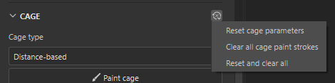

# Käfig-Malerei

Mit **Käfig-Painting** können Sie Bereiche Malen, um den Baking führend Käfig weiter weg zu schieben oder näher an die Oberfläche mit geringer Polung heranzuführen. Mit dem Käfig-Painting können Sie Artefakte während des Bakings verhindern, während Sie gleichzeitig alle polyvalenten Details Ihres Meshs erfassen.

*Der linke Handschuh, Baking geführt mit einem Käfig auf Distanzbasis und einem niedrigen Abstand auf der Vorderseite von Max, zeigt Baking führend Artefakte, einschließlich der Verzerrung und der Bereiche, in denen der Käfig den Mesh mit hohem Poly schneidet, und verliert dabei an Details. Der rechte Handschuh wurde mit denselben Einstellungen Baking geführt, jedoch mit Käfig-Maleffekt, um die Größe des Käfigs zu steuern.*

>[!NOTE]
>
> Käfig-Malerei unterteilt den Käfig-Mesh automatisch, was bedeutet, dass der Käfig selbst bei Meshs mit niedriger Auflösung so weit geschoben und gezogen werden kann, dass er alle Details abdeckt.

## Einrichten des Käfig-Malens

Damit **Käfig-Painting** verfügbar ist, muss das Projekt über mindestens eine Datei mit hoher Szene verfügen, von der aus Baking geführt werden kann, und der Käfig-Typ muss auf **entfernungsbasiert** festgelegt sein.

>[!NOTE]
>
> Unterstützung für **Käfig-Malerei** wird in einer zukünftigen Version für den **automatischen Käfig-Typ** hinzugefügt.

Es wird empfohlen, die Werte **Maximaler frontaler Abstand** und **Relativ zum Begrenzungsrahmen** festzulegen, bevor Sie mit dem Malen Ihres Käfigs beginnen, da das Ändern dieser Werte nach dem Malen möglicherweise ein Retuschieren oder sogar ein erneutes Malen des Käfigs von Grund auf erfordert.

>[!TIP]
>
> Wenn Sie das Käfig-Malen von Grund auf neu beginnen möchten, setzen Sie die Käfig-Malparameter, die Käfig-Malstriche oder alle Baking-Einstellungen zurück.
>
> 

## Käfig malen

So beginnen Sie mit dem Käfig-Malen:

1. Wechseln Sie in den [**Baking-Modus**](baking.md).
1. Stellen Sie sicher, dass Sie mindestens eine **Datei mit hoher Poly-Szene** ausgewählt haben, von der Baking geführt werden soll.
1. Navigieren Sie im Bereich **Allgemeine Einstellungen** **Bereich** zum Abschnitt **Käfig**.
1. Legen Sie den **Käfig type** auf **Distance-based** fest.
1. Klicken Sie auf **Malen Käfig**.

>[!VIDEO](https://video.tv.adobe.com/v/3504611?learn=on)

*Dieses Video zeigt, wie ein neues Projekt für das Malen von Käfigen eingerichtet wird. Zuerst wechseln wir in den Baking-Modus, dann wählen Sie eine High-Poly-Szene. Der entfernungsbasierte Käfig-Typ ist standardmäßig ausgewählt, sodass wir sofort mit dem Malen des Käfigs beginnen können.*

>[!NOTE]
>
> Standardmäßig ist **Auto-reframe** für den normalen Kanal aktiviert, wenn Sie zum ersten Mal **Käfig-Malerei** eingeben. Dies bedeutet, dass der Normalen-Map bei jeder Änderung des Käfigs automatisch umgebrochen wird. **Automatisches Rebake** im Bedienfeld [**Mesh-Map-Baker aktivieren oder deaktivieren**](../interface/baking-panels/mesh-map-bakers.md).
>
> 

Sobald Sie den Käfig-Malmodus aufrufen, zeigt die Standardvisualisierung in **Viewport** Folgendes an:

* Der Käfig um den Mesh in Beige.
* Bereiche, in denen die hohe Poly den Käfig in leuchtendem Rot schneidet.
* Käfig bemalte Bereiche in Grün (positiv) und Blau (negativ) auf der Oberfläche mit wenig Mesh.

Verwenden Sie im Käfig-Malmodus das [**Elementvisualisierungsmenü**](baking-visualization-settings.md) im **Viewport**, um die Darstellung der einzelnen Baking anzupassen.

>[!NOTE]
>
> Die leuchtend rote Visualisierung von Kreuzungen mit dem Käfig ist eine ungefähre Vorschau und stimmt nicht genau mit den endgültigen Baking-Ergebnissen überein. In den meisten Fällen ist die Visualisierung recht präzise, aber bei Meshs mit geringem Poly-Wert und langen, dünnen Polygonen kann sie falsch sein. Für diese Mesh ist es besser, **Quick Baking** oder **Auto-Rebake** zu verwenden, um das Endergebnis zu überprüfen.

## Käfig-Malwerkzeuge

Beim Malen des Käfigs können Sie viele der Tools und Tastaturbefehle verwenden, die Sie vom **Malmodus** gewohnt sind, einschließlich der **Pinsel**, **Radiergummi** und **Polygonfüllung**.

* Sie können von der Symbolleiste aus zwischen **Pinsel**, **Radiergummi** und **Polygonfüllung** wechseln oder die standardmäßigen [Tastaturbefehle](../interface/settings/shortcuts.md) im Malmodus verwenden.
* Bei Verwendung der Tools **Paintbrush** oder **Radiergummi** können Sie die Größe, den Fluss, die Deckkraft und den Abstand des Tools mithilfe der Parameter oben im **Viewport** anpassen. Sofern verfügbar, können Sie auch die entsprechenden [Tastaturbefehle](../interface/settings/shortcuts.md) verwenden.

### Pinsel

Die Verwendung des **Pinsels** in voller **Stärke**, **Fluss** und **Deckkraft** hat einen großen Einfluss auf die Käfig-Oberfläche. Es wird empfohlen, einen sehr niedrigen Wert für **Stärke** festzulegen und die Parameter &quot;Fluss&quot; und &quot;Deckkraft&quot; zu verwenden, um die Stärke des Pinsels zu steuern.

*In diesem Beispiel ist der erste Pinselstrich viel zu stark, selbst bei einer Stärke von 0,05. Nachdem wir die Deckkraft für Stärke, Fluss und Kontur verringert haben, haben wir viel mehr Kontrolle über den Effekt.*

### Radiergummi

Mit dem Radiergummi-Werkzeug können Sie Malen aus dem Käfig entfernen und gelöschte Bereiche effektiv auf die Standardgröße des Käfigs zurücksetzen.

### Polygon-Füllen

Im **Käfig-Malen** **Modus** verfügt das **Polygon-Füllwerkzeug** über eine zusätzliche Funktion. Ein **Stärke-Schieberegler** wird im **Viewport** angezeigt, wenn Sie Änderungen vornehmen, mit denen Sie den Wert für den letzten Satz von ausgewählten Polygonen anpassen können.

Diese Funktion ist besonders nützlich für Korrekturen pro Element mithilfe des Füllmodus **Mesh** in Szenen mit mehreren separaten Meshs.

>[!NOTE]
>
> Diese Funktion führt den letzten Vorgang (Anwenden der Polygonfüllung) mit einem anderen Wert für die Stärke erneut aus. Infolgedessen verschwindet der Schieberegler, wenn Sie einen anderen Vorgang ausführen oder Werkzeuge ändern.

Oft ist es sinnvoll, den gleichen Wert für die Bemalung des Käfigs auf mehrere Bereiche des Meshs anzuwenden. Gehen Sie folgendermaßen vor:

1. Wählen Sie den ersten Polygonsatz aus.
1. Verwenden Sie den Regler **Käfig Stärke**, um die Stärke des Effekts anzupassen.
1. Kopieren Sie den Wert **Käfig Stärke** aus dem temporären Schieberegler in **Viewport**.
1. Fügen Sie den Wert in den Schieberegler **Stärke** oben im **Viewport** ein.
1. Wählen Sie die nachfolgenden Sätze von Polygonen aus, um denselben Wert für die Stärke anzuwenden.

Im folgenden Video wird dieser Arbeitsablauf in Aktion gezeigt. Dabei wird die **Polygonfüllung** **Werkzeug** mit **Mesh-Füllung** ausgewählt.

>[!VIDEO](https://video.tv.adobe.com/v/3504621?learn=on)

>[!NOTE]
>
> Wenn Sie diese Schritte ausführen, ist es möglicherweise hilfreich, den **normalen Mischmodus** auszuwählen, damit das Polygon-Füllwerkzeug die vorhandenen gemalten Werte überschreibt, anstatt sie zu ergänzen.

### Überblendung

Standardmäßig wird für die Werkzeuge **Pinsel** und **Polygonfüllung** der Mischmodus **Linear abwedeln (Hinzufügen)** verwendet, Sie können jedoch auch die Mischmodi **Normal** und **Aufhellen (Max)** verwenden.

* **Linear abwedeln (hinzufügen)**
  * Mit jeder Kontur/jedem Stempel wird der angegebene Wert für die Stärke zum vorhandenen Wert hinzugefügt oder vom vorhandenen Wert abgezogen.
  * Dieser Mischmodus funktioniert ähnlich wie bei 3D-Modellierungsanwendungen, bei denen jeder von Ihnen Malen Strich zur Mesh-Oberfläche hinzufügt.
* **Normal**
  * Jeder Strich/Stempel legt den Wert auf die angegebene Stärke fest und überschreibt den vorhandenen Wert.
  * Dieser Mischmodus verhält sich wie der Standard-Pinsel im Malmodus, sodass Sie die vorhandene Oberfläche mit einem anderen Wert abdecken können.
* **Aufhellen (max.)**:
  * Jede Kontur/jeder Stempel wählt den Maximalwert zwischen der Stärke und dem vorhandenen Wert aus.
  * Bei dieser Füllmethode dauert es länger, bis die Kanten des Pinsels auf den nachfolgenden Strichen aufbauen, was einen fließenderen Übergang ermöglicht.