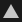
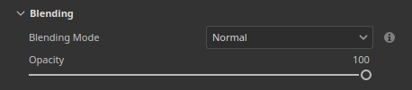

# Polygon-Füllen

Das Werkzeug **Polygonfüllung** füllt Polygone mit Material- oder Graustufenmaskenwerten. Sie kann für Malebenen, Effekte und Masken verwendet werden, um Bereiche des Meshs schnell zu füllen.

Dieses Werkzeug ist eher ein Malwerkzeug als ein Auswahlwerkzeug: Deshalb kann es nach der Verwendung nur über das Radiergummi-Werkzeug oder durch Überfüllen gelöscht werden.

Der Zugriff auf das Werkzeug ist über die Werkzeugleiste möglich:

## Einstellungen

Unten finden Sie die Liste der Einstellungen, die mit dem Werkzeug **Polygonfüllung** über das Fenster **Eigenschaften** verfügbar sind.

### Auswahlmodus

Der Auswahlmodus steuert, wie Dreiecke und Vierecke der Geometrie des Meshs ausgewählt werden.

| **Modus** | **Beschreibung** |
|---|---|
|  **Auswahlrechteck-Füllung** | Zeichnen Sie eine rechteckige Auswahl, indem Sie darauf klicken und ziehen. Im **Füllmodus** wird definiert, welche Geometrie gefüllt wird, während **Hit-test** definiert, welche Polygone enthalten sind. 4   |
|  **Polygonschleifenfüllung** | Füllen Sie eine vollständige Quad-Schleife mit einem einzigen Klick. Durch Ziehen werden mehrere Endlosschleifen ausgewählt.    |
|  **Teilweise Polygonschleifenfüllung** | Teile einer Schleife durch Klicken und Ziehen füllen. Die Auswahl kann sich entlang sekundärer Schleifen erstrecken, um einen Bereich von Polygonen zu bilden.    |

### Füllmodus

Der Füllmodus, der nur mit dem Modus **Auswahlrechteck-Füllung** verwendet werden kann, steuert, welche Teile der Geometrie ausgewählt werden.

| **Modus** | **Beschreibung** |
|---|---|
|  **Dreiecksfüllung** | Einzelne Mesh-Dreiecke füllen. |
|  **Polygonfüllung** | Füllen Sie ganze Polygone. Bei einem Mesh, der vor dem Import trianguliert wurde, ist das Ergebnis das gleiche wie **Dreiecksfüllung**. |
|  **Mesh füllen** | Füllen Sie jedes Polygon, das mit dem angeklickten Polygon verbunden ist. |
|  **UV-Blockfüllung** | Polygone, die im UV-Raum verbunden sind. Die Füllung endet an den Rändern der UV. |

### Treffertest

Die Treffertesteinstellungen steuern, wie Dreiecke und Quads vom Modus **Auswahlrechteck-Füllung** ausgewählt werden.

| **Modus** | **Beschreibung** |
|---|---|
|  **Schnittmenge** | (Standard) Ein Polygon wird gefüllt, wenn sich ein Teil seiner Geometrie innerhalb des Auswahlbereichs befindet oder den Auswahlbereich schneidet. |
|  **Enthaltenes Zentrum** | Ein Polygon wird nur gefüllt, wenn sein Mittelpunkt innerhalb des Auswahlbereichs liegt. |
| **Nur sichtbare Polygone** | Wenn diese Option aktiviert ist, wirkt sich das Füllen nur auf Polygone aus, die in der aktuellen Kamera angezeigt werden. Eingeschlossene und nach hinten gerichtete Polygone werden ignoriert. Wenn diese Option deaktiviert ist, können Polygone durch den Mesh hindurch gefüllt werden. |

### Überblenden

Diese Einstellungen steuern, wie das Füllergebnis mit den darunter liegenden Pixeln gemischt wird.

| **Parameter** | **Beschreibung** |
|---|---|
| Überblendmodus | Steuern Sie, wie die Füllung mit vorhandenen Pixelwerten vermischt wird. Im Modus &quot;**Material**&quot; gilt der Mischmodus für alle im Abschnitt &quot;**Material**&quot; aktivierten Kanäle. |
| Deckkraft | Steuern Sie die Deckkraft der Füllung. |

>[!NOTE]
>
> Das Tool unterstützt dieselben Füllmethoden, die auch im Ebenenstapel verfügbar sind. Weitere Informationen finden Sie auf der Dokumentationsseite zu den [Füllmethoden](https://experienceleague.adobe.com/en/docs/substance-3d-painter/using/interface/layer-stack/blending-modes).

### Material

Der Abschnitt &quot;Material&quot; steuert, welche Kanäle mit dem Werkzeug gemalt werden können.

## Tastaturkürzel

Das Polygon-Füllwerkzeug kann mithilfe bestimmter Tastaturbefehle effektiv verwendet werden:

| **Tastaturbefehl** | **Beschreibung** |
|---|---|
| **Alt** | Mit der **Polygonschleifenfüllung** und der **partiellen Polygonschleifenfüllung** erweitert dieser Tastaturbefehl die Auswahl auf der anderen Seite des ursprünglichen Klickens, während er gezogen wird. 4   |
| **Umschalttaste** | Mit der **partiellen Polygonschleifenfüllung** füllt dieser Tastaturbefehl nur die primäre Schleife, wobei die sekundären Schleifen ignoriert werden. Beispiel für das Umschalten von **Umschalt**: 2   |
| **Umschalttaste + A** | Dieser Tastaturbefehl wechselt vorübergehend von einem anderen Auswahlmodus zu **Polygonschleifenfüllung**. Wenn der Tastaturbefehl vor der Maustaste losgelassen wird, wird die Auswahl fortgesetzt, bis die Maustaste losgelassen wird. |
| **A** | Wenn dieser Tastaturbefehl beim Ziehen gedrückt wird, wird das aktuelle Ergebnis mit dem vorherigen Ergebnis kombiniert. Dies funktioniert über Füllmethoden und Deckkraft hinweg:    |

## Einschränkungen

Für das Tool gelten einige Einschränkungen:

* **Polygonschleifenfüllung** und **Partielle Polygonschleifenfüllung** funktionieren nur bei Quads, sodass Dreiecke und n-Gons nicht mit diesen Modi gefüllt werden können.
* Die Unterstützung für **Radial Symmetrie** ist ebenfalls eingeschränkt und möglicherweise unzuverlässig. Um Symmetrie zu verwenden, verwenden Sie stattdessen den Spiegelmodus. Weitere Informationen finden Sie auf der [Symmetrie-Dokumentationsseite ](https://experienceleague.adobe.com/en/docs/substance-3d-painter/using/painting/symmetry/symmetry).
* Das Tool füllt nur die Geometrie des **aktiven Textursatzes** aus. Das Drahtgitter wird für diesen Textursatz angezeigt und aktualisiert, wenn sich der aktive Textursatz ändert.
