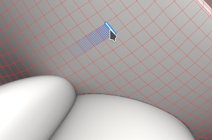

# Version 12.2

**Substance 3D Painter 12.2** bietet ein verbessertes Polygon-Füllwerkzeug mit schleifenbasierter Auswahl, Käfig-Maleffekten für das Baking, Textursatz-Hervorhebung im Viewport und sortenunabhängiger Transparenz für Echtzeit-Rendering.

Freigabedatum: **21. Oktober 2026**

## Wichtigste Funktionen

### Verbesserte Polygonfüllung

Das Werkzeug **Polygonfüllung** wurde mit einer neuen Schnittstelle und neuen Auswahlmodi für Polygonschleifen überarbeitet. Das Werkzeug unterstützt jetzt auch Füllmethoden mit einer Deckkraftsteuerung und kann auf mehreren Kanälen gleichzeitig arbeiten. Auch die Verdeckung des Auswahlpunkts wird berücksichtigt, was bedeutet, dass die in der Kamera ausgeblendeten Polygone ignoriert werden.

* **Verbesserte Schnittstelle**

  Die Einstellungen für **Polygonfüllung** im Fenster **Eigenschaften** wurden überarbeitet, um eine einfachere Verwendung zu ermöglichen. Die Optionen werden jetzt als Schaltflächenzeilen angezeigt, wodurch der Wechsel zwischen Modi beschleunigt wird. Neue QuickInfo-Symbole beschreiben, wie jeder Modus funktioniert.

  

* **Neue Auswahlmodi**

  Der Zeile **Auswahlmodus** wurden zwei neue Modi hinzugefügt, die Polygonschleifen gewidmet sind:

  

  * **Polygonschleifenfüllung**: Dieser Modus füllt eine komplette Quad-Schleife mit einem einzigen Klick. Wenn Sie beim Ziehen **Alt** gedrückt halten, wird die Auswahl ebenfalls in die entgegengesetzte Richtung erweitert.

    

  * **Teilweise Polygonschleifenfüllung**: In diesem Modus wird nur ein Teil einer Schleife ausgefüllt. Durch Ziehen entlang der Schleife wird die Auswahl erweitert. Während des Ziehens zeigen die Pfeile den Topologiefluss auf jeder Seite der Auswahl an, um unerwartete Pfadänderungen vorherzusehen. Eine QuickInfo neben dem Cursor zeigt die Anzahl der auf beiden Achsen ausgewählten Polygone an. Wenn Sie beim Ziehen **Alt** gedrückt halten, wird die Auswahl ebenfalls in die entgegengesetzte Richtung erweitert.

    

  Wenn Sie **Umschalt + A** gedrückt halten, wird von einem beliebigen Auswahlmodus aus auch vorübergehend zur **Polygonschleifenfüllung** gewechselt. Wenn der Tastaturbefehl vor der Maustaste losgelassen wird, wird die Auswahl fortgesetzt, bis die Maustaste losgelassen wird.

* **Füllmodus wechselt den Auswahlmodus**

  Die Optionen für den **Füllmodus** gelten nicht für die Modi **Polygonschleifenfüllung** und **Partielle Polygonschleifenfüllung**. Aus diesem Grund wird durch Auswählen eines Füllmodus der **Auswahlmodus** automatisch wieder auf den Hauptmodus zurückgesetzt.

  

* **Neue Treffertestoption**

  Die neue Option **Hit-test** steuert, welche Polygone im Auswahlbereich enthalten sind. Das Verwerfen nicht sichtbarer Polygone ist jetzt das Standardverhalten, da die Option **Nur sichtbare Polygone** standardmäßig aktiviert ist. Wenn Sie diese Option deaktivieren, wird das vorherige Verhalten beim Ausfüllen des Meshs wiederhergestellt.

  Folgende Optionen sind verfügbar:

  * **Schnittmenge**: (Standard) Ein Polygon wird gefüllt, wenn sich ein Teil des Polygons innerhalb des Auswahlbereichs befindet oder die Kante überschreitet.
  * **Enthaltenes Zentrum**: Ein Polygon wird nur gefüllt, wenn sein Mittelpunkt innerhalb des Auswahlbereichs liegt.
  * **Nur sichtbare Polygone**: Wenn diese Option aktiviert ist, füllt sie nur die Polygone aus, die in der Ansicht der aktuellen Kamera angezeigt werden. Die verdeckte und nach hinten gerichtete Geometrie wird daher ignoriert.

  

* **Füllmethoden und Deckkraft**

  Das Werkzeug **Polygonfüllung** unterstützt jetzt alle Füllmethoden, die gleiche Liste wie die im Ebenenstapel verfügbare. Beispiel: **Linear abwedeln (Add)** fügt den vorhandenen Werten Werte hinzu, anstatt sie zu ersetzen. Die Modi sind im neuen Abschnitt &quot;**Füllmethode**&quot; des Fensters &quot;**Eigenschaften**&quot; zusätzlich zum Regler &quot;**Deckkraft**&quot; verfügbar. Im Modus &quot;**Material**&quot; gilt der Mischmodus für alle im Abschnitt &quot;**Material**&quot; aktivierten Kanäle.

  

* **Mehrere Kanäle gleichzeitig füllen**

  Das Werkzeug **Polygonfüllung** ist nicht mehr auf eine Ein Kanal beschränkt. Alle Kanaleigenschaften, die im Abschnitt **Material** aktiviert sind, können jetzt festgelegt und in einer Aktion ausgefüllt werden.

  

* **Kompatibel mit Symmetrie**

  **Polygonschleifenfüllung** und **Partielle Polygonschleifenfüllung** funktionieren auch mit Symmetrie. Ein einzelner Klick funktioniert mit der gespiegelten Symmetrie (die radiale Symmetrie ist jedoch möglicherweise weniger zuverlässig).

  

* **Vorherigen Strich fortsetzen**

  Der Tastaturbefehl **Vorherigen Strich fortsetzen** (wobei **A** gedrückt bleibt) funktioniert jetzt mit dem Werkzeug **Polygonfüllung**, einschließlich aller Füllmethoden und Deckkraft.

  

* **Klareres Feedback über Textursatz hinweg**

  Das Drahtgitter wird jetzt nur für den aktiven Textursatz angezeigt und wird aktualisiert, wenn sich die Auswahl ändert. Beim Bewegen der Geometrie aus einem anderen Textursatz wird jetzt ein unzulässiger Cursor angezeigt, der angibt, dass die zugehörige Geometrie nicht gefüllt werden kann.

  

>[!NOTE]
>
> Weitere Informationen zum Werkzeug **Polygonfüllung** finden Sie auf der [Seite der dedizierten Dokumentation](https://experienceleague.adobe.com/en/docs/substance-3d-painter/using/painting/paint-tools/polygon-fill).

### Malen mit neuem Käfig im Baking-Modus

Der neue **Käfig-Malmodus** ist ein Käfig-Offset pro Pixel, der über den globalen Distanzoffset gemalt werden kann. Das bedeutet, dass der Käfig jetzt durch Malen direkt auf den Mesh justiert werden kann. Bereiche, in denen sich die High-Poly-Mesh außerhalb des Käfigs befindet, können dann leichter lokal fixiert werden.

* **Neues Malen des Käfig-Offsets**

  Eine neue Schaltfläche **Malen Käfig** im Baking-Modus wechselt jetzt in den Käfig-Malmodus. In diesem Modus können die Tools **Malen**, **Radiergummi** und **Polygonfüllung** verwendet werden, um den Abstand des Käfigs zur Low-Poly-Mesh anzupassen.

  

  Dies geschieht durch Malen einer mittleren Textur. Diese Textur wird dann beim Baking als Versatz auf dem Mesh des Käfigs verwendet. Dies ähnelt dem **Skew-Painting**-Prozess.

  Ein Parameter **Stärke** in der oberen Symbolleiste legt den Versatzwert fest, der durch die Kontur angewendet wird. Die üblichen Steuerelemente **Größe**, **Fluss**, **Konturdeckkraft** und **Abstand** sind ebenfalls verfügbar. Außerdem ist eine Schaltfläche **Wert umkehren** verfügbar. Symmetrie wird ebenfalls unterstützt.

  

  

* **Mit der Polygon-Füllung ganze Mesh-Teile auswählen und füllen**

  Das Werkzeug **Polygonfüllung** kann den Käfig von Teil- oder ganzen Unterobjekten gleichzeitig anpassen. Wenn Sie auf ein Element klicken, wird eine unverankerte Symbolleiste mit einem Schieberegler der Stärke **Käfig** geöffnet. Dieser Schieberegler vergrößert oder verkleinert den Käfig in Echtzeit, beginnend mit dem in der oberen Symbolleiste festgelegten Wert. Dann werden über dem Versatz die gestrichelten Versätze hinzugefügt.

  

* **Käfig-Offsets im Viewport anzeigen**

  Durch Aufrufen des Käfig-Malmodus wechselt der Viewport in einen neuen Ansichtsmodus. In diesem Modus werden die Abstände als grüne Überlagerung über dem Käfig angezeigt. Der Käfig wird auch so deformiert, dass er den Käfig-Mesh darstellt, der während des Bakings verwendet wird.

  

  Einige Einstellungen können über das Fenster **Visualisierung des Bakings** festgelegt werden: Der Abschnitt **Käfig** steuert die **Käfig-Oberfläche** und die **Käfig-Drahtgitter** sowie deren Deckkraft. Sie verfügt außerdem über eine **Offset-Raster-Deckkraft** und eine **Offset-Schattierung-Stärke**.

  

* **Füllmethode in der kontextabhängigen Symbolleiste**

  Verschiedene Füllmethoden stehen zur Verfügung, wenn du etwas mehr Platz brauchst. Sie können verwendet werden, um den Versatz des Käfigs einfacher anzupassen, insbesondere um Versätze hinzuzufügen oder zu entfernen.

  Die verfügbaren Modi sind:

  * **Normal**: ersetzt den vorhandenen Versatz durch den Konturwert.
  * **Aufhellen (max.)**: behält den höheren Wert der Kontur und den vorhandenen Versatz bei.
  * **Linear abwedeln (Hinzufügen)**: (Standard) fügt dem vorhandenen Versatz den Strichwert hinzu.

  

  Mit **Polygonfüllung** sind zusätzliche Mischmodi verfügbar, indem Sie das Kontextmenü im Viewport verwenden.

* **Neues Menü zum Zurücksetzen von Käfig und Neigung**

  Beide Malmodi &quot;Neigen&quot; und &quot;Käfig&quot; verfügen jetzt über ein neues Menü zum Zurücksetzen der Einstellungen. Verfügbare Optionen sind:

  * **Käfig-/Versatzparameter zurücksetzen**: die UI-Parameter auf ihre Standardwerte zurücksetzen.
  * **Alle Käfig-/Skew-Malen-Striche löschen**: Löschen Sie die für das Käfig- oder Neigungsbild verwendete Textur.
  * **Zurücksetzen und Löschen aller**: Kombinieren Sie sowohl das Zurücksetzen der Benutzeroberfläche als auch das Löschen der Käfig-/Neigungseinstellungen.

  

>[!NOTE]
>
> Weitere Informationen zum Baking finden Sie auf der [dedizierten Dokumentationsseite ](https://experienceleague.adobe.com/en/docs/substance-3d-painter/using/baking/baking).

### Hervorhebung von neuem Textursatz im Viewport

Mit dem neuen Hervorhebungsverhalten können Sie jetzt identifizieren, welche Geometrien im 3D-Viewport einem **Textursatz** oder einer **UV-Kachel** zugeordnet sind.

* **Hervorhebung aus der Liste der Textursatz**

  Wenn Sie mit dem Mauszeiger auf einen Eintrag in der Liste &quot;**Textursatz&quot;** zeigen, wird nun seine Geometrie im Viewport hervorgehoben, sowohl für Textursatz als auch für UV-Kacheln. Dadurch ist leicht erkennbar, welcher Teil des Meshs zu jedem Textursatz gehört.

  

* **Hervorhebung vom Viewport**

  Wenn Sie **Strg/Befehl+Alt** über dem Modell halten, wird die Geometrie des Textursatzes unter dem Cursor hervorgehoben. Die Markierung wird ausgeblendet, während die linke Maustaste gedrückt wird oder während des Schwenkens, und kehrt zurück, sobald die Modifikatoren losgelassen werden.

* **Verfügbar in Mal- und Baking führ-Modi**

  Die Hervorhebung funktioniert sowohl im Mal- als auch im Baking führ-Modus. Im Baking-Modus werden deaktivierte Textursätze grau dargestellt, wenn sie hervorgehoben werden.

### Neue auftragsunabhängige Transparenz

Der Echtzeit-Viewport unterstützt jetzt auftragsunabhängige Transparenz. Es entfernt die Sortierartefakte und Flackern, die auftreten können, wenn sich mehrere transparente oder lichtdurchlässige Flächen überlappen.

* **Neue Option in den Anzeigeeinstellungen**

  Die Option **Bestellunabhängige Transparenz** kann im Abschnitt **Rendereinstellungen** der **Anzeigeeinstellungen** aktiviert werden. Sie ist standardmäßig deaktiviert, um Leistungsbeeinträchtigungen zu vermeiden.

  

  Vor und nach der Aktivierung der neuen Einstellung:

  

* **Leistungssteuerung**

  Ein Parameter **Sortierkapazität** steuert die durchschnittliche Anzahl der Transparenzebenen, die pro Pixel sortiert werden können. Höhere Werte verbessern die Transparenzqualität in komplexen Szenen, können jedoch mehr Speicher verbrauchen und die Leistung beeinträchtigen. Folgende Optionen sind verfügbar:

  * **Niedrig (1x)**.
  * **Mittel (2x)**.
  * **Hoch (4x)** (Standard)
  * **Sehr hoch (8x)**
  * **Ultra (16x)**

### Verschiedene Verbesserungen

In dieser Version wurden zusätzliche Funktionen und Verbesserungen hinzugefügt:

* **Reorganisierte Anzeigeeinstellungen**

  Die Parameter des Fensters &quot;**Anzeigeeinstellungen**&quot; wurden neu gruppiert und angeordnet, sodass das Fenster leichter navigiert werden kann. Die Einstellungen sind jetzt in **Umgebungseinstellungen**, **Kamera-Einstellungen**, **Post-Effekte**, **Rendereinstellungen** und **Visualisierungseinstellungen** aufgeteilt. Über eine Reihe von Schaltflächen oben im Fenster können Sie direkt zu jeder Gruppe springen.

  

* **Additive Überblendung mit Pinselstrichen**

  Die Pinseleinstellungen bieten jetzt einen neuen additiven Mischmodus. In diesem Modus werden Konturen in derselben Ebene übereinander addiert, anstatt einander zu ersetzen. Dies ist nicht auf Stempel innerhalb eines Strichs beschränkt. Mit diesem neuen Modus kann Farbe additiv hinzugefügt werden, oder der Height-Kanal kann durch Hinzufügen oder Entfernen von Werten modelliert werden.

  

* **Neue UV-Nachbar-Engine-Zuordnung**

  Für das Substance von Materialien und Filtern ist eine neue `mesh_uv_neighbor`-Engine-Map-Eingabe verfügbar. Es funktioniert wie eine UV Advektion-Textur, um die andere Seite einer UV-Insel-Naht zu finden. Die Rot- und Grün-Kanäle speichern den UV-Vorschub, der verwendet wird, um die benachbarten Pixel über eine UV-Naht zu erreichen.

  Weitere Informationen zu diesen Engine-Texturen finden Sie auf der [dedizierten Dokumentationsseite ](https://experienceleague.adobe.com/en/docs/substance-3d-painter/using/content/creating-custom-effects/mesh-based-input).

## Versionshinweise

### 12.2.0

Demnächst verfügbar.